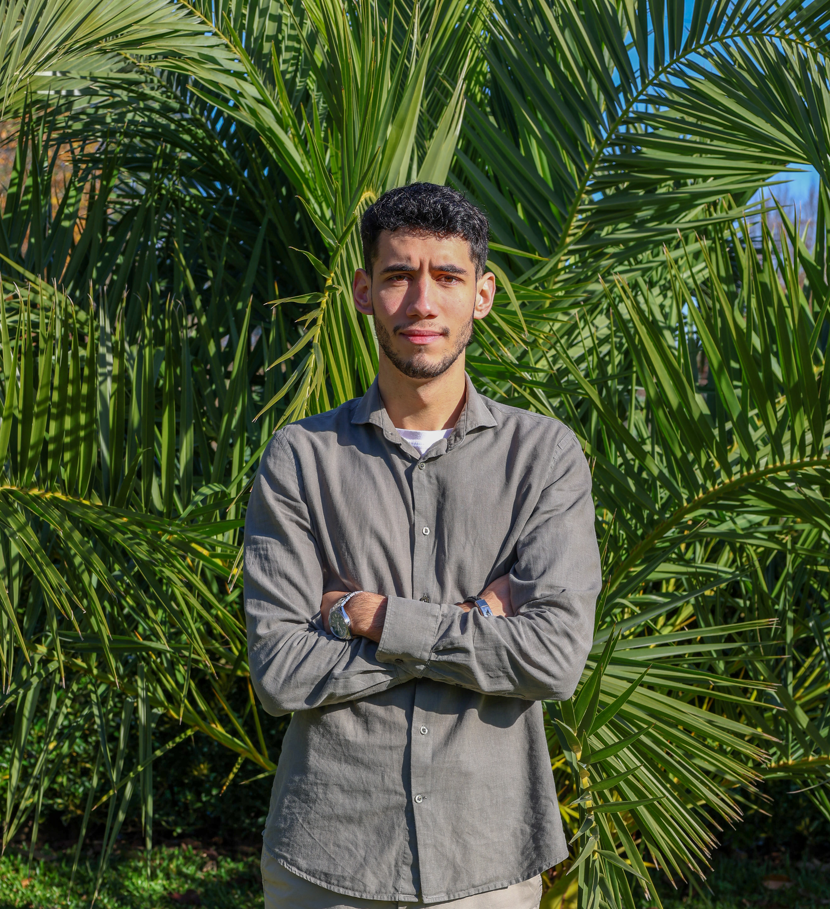

# About me

{ align=right width=220 }

Hi, I'm Diogo, a developer in training from [your city], Portugal. I'm happiest
when I'm learning something new, whether that's a programming language, a tool,
or how a game I love was built.

## What I do

I'm building my foundations in **Python**, **HTML/CSS/JavaScript** and **Git**,
and learning how code travels from my laptop to a published site through CI/CD
pipelines. This portfolio is part of that practice: it's built with MkDocs and
the Material theme, customised with my own CSS and JavaScript.

## Games

I'm a playtester, and that's where my passion for game development started.
Playtesting taught me to notice what feels good and what feels broken, and to
describe a problem clearly enough for a developer to fix it. Now I want to move
to the other side of the screen and build [what you want to make, e.g. small
2D games]. Some games that shaped me: [2 or 3 titles].

## Music

Music is always on, whether I'm coding, gaming or editing photos. I mostly
listen to hip-hop and R&B, with **The Weeknd** way out in front. I like looking
at my own habits as data, so the **Music** tab shows my listening stats, built
from my own Spotify export with a Python script.

## Photography

I photograph [what you shoot: streets, landscapes, friends...]. It trained my
eye for composition and detail, which also helps when I design interfaces. See
my favourites in the **Photography** tab.

## What I'm looking for

A team where I can learn from experienced engineers, build useful tools, and
keep growing.
